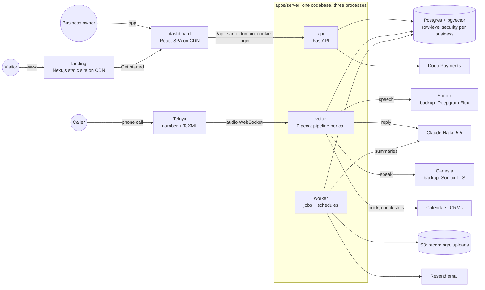

# AI Receptionist: Architecture

How the product is built, from a one-person plumbing business to a large hospital, while keeping every plan at an 80%+ margin. Updated 2026-10-31 with lessons from the AI books in `learn/`, `full-pdf/` and `in-complete/` (section 3). Cloud prices are approximate list prices; check them in the AWS Pricing Calculator before buying.

---

## 1. Principles

1. **Three apps, one backend.**
   - `apps/landing` (Next.js) sells the product.
   - `apps/dashboard` (React) is where customers set it up.
   - `apps/server` (Python) does everything else.

   Neither frontend has its own backend, so there is one place for business logic, auth and data.
2. **One backend language: Python.** The call framework (Pipecat) and the AI libraries are Python, so the API, live calls and background jobs all use it.
3. **One server codebase, three processes.** The code is shared, but each process has its own job, so a slow job never delays a live call:
   - `api`: the dashboard's REST API;
   - `voice`: live calls;
   - `worker`: background jobs and schedules.
4. **Every customer shares one platform.** Each business's data is kept apart inside the database itself (Postgres row-level security). A separate database is only for enterprise contracts that pay for it, built from the same code.
5. **Pay only for what runs.** No Kubernetes, load balancer, Redis or separate vector database until real load needs them. Postgres does the data, search index, job queue and locks. Both frontends are static files on a CDN.
6. **No AI models on our servers.** Listening, thinking and speaking all go through provider APIs. Every provider has a backup.
7. **A live call never goes silent.**
   - Every outside call has a deadline.
   - Every provider has a backup and a circuit breaker.
   - When everything fails, take a message or transfer to the business.
8. **The AI acts only through one guarded door.** Booking, transferring or messaging goes through a tool executor that checks permissions, enforces an idempotency key and writes an audit row. The model never decides who the caller or business is.
9. **One source of truth for the API.** FastAPI publishes an OpenAPI description, and the dashboard's TypeScript client is generated from it. CI fails if they drift.
10. **Everything reproducible:** infrastructure as code, images built once in CI, and the same images in staging and production.

---

## 2. System diagram



---

## 3. What the AI books changed

Three readers went through the books that fit this product. These are the decisions that came out of them. The books are interview-prep guides, so their numbers are starting points to measure against, not facts. Page numbers are the books' printed pages.

| Area | Decision | Source |
|---|---|---|
| **Tenancy** | Keep shared tables with row-level security. The books call it the right default for up to tens of thousands of tenants. A separate schema or database only when a contract or regulator requires it, so add an organization → database router later. Background jobs and usage rollups need to see every organization: give them narrow `SECURITY DEFINER` functions, as `resolve_phone_number` already does, never a role that bypasses the rules. | multi-tenant RAG p.3–7, 34 |
| **Latency budget** | Callers feel a reply over ~800 ms as broken. Budget per stage: end-of-turn 200–600 ms, speech-to-text final 50–200, LLM first token 100–500, voice first audio 50–200, network 20–100. Measure **p95 time to first audio** per turn, never the average. | voice AI p.37–40 |
| **Turn-taking** | A fixed silence timer is usually the real cause of slowness: use the listener's own end-of-turn detection. When the caller interrupts, stop the voice and the LLM and flush Telnyx's audio buffer. Ignore "uh-huh" backchannels. | voice AI p.40–41, 84 |
| **Deadlines** | Every outside call gets a connect timeout (1–2 s) and a read timeout. Each turn has a deadline that is passed down, so a hop gets "whatever time is left", with 10% kept back to say a fallback line. A watchdog catches sockets that hang without closing. | chaos p.125–135 |
| **Failures** | Per provider: a separate connection pool, at most one fast retry (and only if the deadline allows), and a circuit breaker that opens after 5 failures in a row or 50% of the last 20. An empty LLM reply counts as a failure. Fallbacks are tested by fake providers that hang, drop or return nothing. | chaos p.127–128, 175–184; tool use p.123–132 |
| **Overload** | Cap calls at once per server and per organization. Over the cap, or while unhealthy, the TeXML forwards the call to the business's own number instead of refusing it. | chaos p.128, 133 |
| **Tools** | One registry lists each tool with its risk level, timeout and whether it's safe to repeat. One guard runs before every tool: deny by default, identity from the call session (never from the model's arguments), refusal reason returned to the model. CI fails on a tool without a risk level. | tool use p.136–140; guardrails p.38–40 |
| **No double bookings** | Every write has an idempotency key from the business event, reserved as `in_flight` before the first attempt. A retry returns the first result. After a timeout, check the calendar before trying again, and say "let me confirm that" instead of "it failed". A worker job settles anything left `in_flight`. | chaos p.62–72; tool use p.13–14, 58–59 |
| **Confirm before acting** | Read back the name, time and phone number before booking. Ask again when the transcription is unsure. A caller is never treated as verified because of their caller ID. | voice AI p.53–55; tool use p.140, 146 |
| **Safety rails outside the model** | A `SafetyGate` step between the LLM and the voice checks each sentence before it's spoken, because speech can't be taken back: no medical advice, nothing outside the business's info. An emergency detector on the listening side forces a transfer. | guardrails p.3, 53–58 |
| **Prompt assembly** | Order: platform rules, then the business's settings, then the caller. Fixed text first, so the prompt cache hits. Business FAQs and caller speech are wrapped in tags as untrusted text. Hours and transfer numbers are looked up from the database, not searched for. | context engineering p.11–13, 44–48, 109–111 |
| **Knowledge** | Row-level security first, plus a check in the search code that every result belongs to the caller's organization. Store the embedding model with each chunk. Combine keyword and vector search. | multi-tenant RAG p.19–20; context engineering p.114 |
| **Usage and caps** | An append-only usage event per call, rolled up per month. Warn the owner at 80% of their minutes. At 100%, overage pricing or transfer. Also cap call length and tool calls per call. Track cost per resolved call against $0.031/min. | multi-tenant RAG p.14, 24–25; routing p.96–112 |
| **Health data** | Pick providers by the organization's compliance tier (HIPAA → only vendors with a signed BAA), not by guessing from what the caller says. Refuse to start a call on an unapproved chain. Redact stored transcripts and logs; don't redact during the call, or the AI can't take a name. | routing p.225–239; multi-tenant RAG p.40–41 |
| **Audit** | `audit_log` is append-only (the app role gets INSERT and SELECT only). It records settings changes, transcript views and exports, logins, deletions, and every tool decision including refusals. A failed audit write never drops a call. | multi-tenant RAG p.32–33; guardrails p.68–72 |
| **Login** | 15-minute access token in an httpOnly cookie, rotating hashed refresh tokens, a strict rate limit on login, and hashed API keys with a visible prefix. People can belong to several organizations, through `memberships`. | FastAPI p.49–53; multi-tenant RAG p.9–11 |
| **Webhooks and jobs** | Check the signature on the raw body, de-duplicate by event ID, answer 200 and queue the work. Queue in the same transaction as the change. Handlers are idempotent; retries back off with jitter; failures go to a dead-letter state. | FastAPI p.45, 65–69 |
| **No AI gateway yet** | One LLM and one route gain nothing from a gateway, and the extra hop adds delay before the first word. Keep a thin `llm` adapter, and reconsider when there's a second LLM vendor or regional stacks. | routing p.2–4, 99–100, 136–139 |
| **Testing the AI** | `evals/` holds cases by intent, language, noise and business type. Grade the final state (was the booking made once?), not the order of steps. Plus fake calendars and CRMs, injected failures, and red-team calls (instructions hidden in speech or CRM fields). Smoke cases on every PR; the full set nightly. A release is blocked by any duplicate write, any action without permission, or any wrong answer that sounded confident. | agentic evals p.6, 44–58, 126, 141–166; tool use p.77–78 |
| **Privacy** | Voice counts as biometric data: get consent for clones, set retention per organization, and when deleting a caller, purge everything derived from them. Never use a voice to prove who someone is. | voice AI p.47–49 |

**Later**, from the same books:
- Canary releases (1–5%, then 25/50/100) with automatic rollback.
- Drift alarms on transcription confidence and on how often callers repeat themselves.
- Caller memory: a recall tool keyed by organization + number, fetched before the first word, deletable.
- Per-organization encryption keys.
- A break-glass admin role before the first hospital.
- A second LLM vendor for failover.

---

## 4. Components

| Part | Stack | What it does | Hosting and scale |
|---|---|---|---|
| **landing** | Next.js 16 (App Router, static export), Tailwind 4 | Marketing site: product, languages, pricing, later blog, legal pages and pages per language. Needs search ranking and a fast first view, which is why it's Next.js. | `next build` writes plain files to `out/`. Served from S3 + CloudFront or Cloudflare Pages for ~$0–5/month; no server to run |
| **dashboard** | React 19, Vite 8, React Router, TanStack Query, Tailwind 4 | Sign-up, setup wizard, business info, voice and languages, numbers, call history, billing. It's behind a login, so search ranking doesn't matter and a single-page app is simpler. | `vite build` writes `dist/`, served at `app.<domain>`. `/api` on the same domain goes to the api, so the login cookie needs no CORS |
| **api** | FastAPI | Auth, organizations, agents, numbers, calls, billing, webhooks (Telnyx, Dodo, calendars) | Stateless; add copies when needed |
| **voice** | FastAPI + Pipecat | Telnyx audio, listen → think → speak, tools, safety gate, per-turn timings, saves the call | Stateless between calls; capped calls per server; drains on deploy |
| **worker** | Python | Summaries and emails, knowledge ingest, calendar and CRM sync, usage rollups, retention cleanup, settling `in_flight` actions | Jobs from Postgres (`FOR UPDATE SKIP LOCKED`); one scheduler via a Postgres lock |
| **Postgres 17 + pgvector** | RDS | All data, search index, queue, locks | Daily backups, point-in-time restore |
| **packages/api-client** | openapi-typescript, openapi-fetch | Types generated from the api's OpenAPI description, plus a typed client | Built into the dashboard |
| **packages/ui** | Tailwind theme | Brand colours and fonts shared by landing and dashboard | — |

---

## 5. A call, step by step

1. A caller dials a business's number. Telnyx streams the audio to `wss://voice.<domain>/telnyx/media/<token>`. If voice is over capacity or unhealthy, TeXML forwards the call to the business instead.
2. **voice** checks the token and finds the business from the dialed number (`resolve_phone_number`). It loads the agent settings and the organization's compliance tier, then picks providers allowed for that tier.
3. **voice** builds the pipeline:
   - Telnyx in;
   - Soniox (or Flux), plus the emergency detector;
   - prompt from `context.py`;
   - Claude Haiku 5.5 with the tool registry;
   - `SafetyGate`;
   - Cartesia;
   - Telnyx out.

   The greeting and AI notice play from pre-recorded audio.
4. Each turn runs against a deadline. Tools go through the guard, carry an idempotency key, and read back details before writing. Timings per stage go to `turn_events`.
5. Limits protect the margin and the caller: maximum call length, maximum tool calls, hang-up after long silence, and spam blocking before the AI answers.
6. When the call ends, **voice** saves the call record (outcome, cost by provider, transcript) and a usage event, then queues `summarize_call`.
7. **worker** writes the summary, emails the owner, pushes the lead to their CRM, rolls up usage, and later deletes the transcript on the organization's retention schedule.

---

## 6. Data model

Every table below `organizations` carries `organization_id` and is limited by row-level security. ✅ = built.

| Table | Holds |
|---|---|
| ✅ `organizations` | Plan, region, HIPAA mode. Next: status, compliance tier, retention days |
| `users`, `memberships`, `refresh_tokens`, `api_keys` | People who log in, their role in each organization, sessions, keys (hashed) |
| `locations` | Branches, hotel properties, hospital departments: address, hours, time zone |
| ✅ `agents` | One receptionist setup. Next: versioned settings (`agent_configs`) |
| ✅ `phone_numbers` | Telnyx numbers → agent |
| ✅ `calls` | One row per call: numbers, language, duration, outcome, transcript, cost |
| `turn_events` | Per-turn timings by stage, interruptions: the latency dashboard |
| `tool_calls` | Every tool decision: arguments (redacted), allowed or refused, result |
| `action_log` | Side effects with a unique `(organization_id, idempotency_key)`, state `in_flight` → `complete` |
| `messages`, `bookings` | What the AI captured for the business |
| `documents`, `knowledge_chunks` | Business knowledge with embeddings, plus the embedding model used |
| `usage_events`, `usage_rollups` | Append-only minutes per call, monthly totals for caps and overage |
| `providers` | Each vendor's region, BAA status and retention, used to choose an allowed chain |
| `integrations` | Calendar and CRM connections (tokens encrypted) |
| `webhook_events` | Received webhooks, with a unique event ID for de-duplication |
| `jobs` | Queue: `run_at`, attempts, `locked_until`, `dedupe_key`, dead-letter state |
| `audit_log` | Append-only: who changed, viewed, exported or deleted what |

---

## 7. Customers of every size

| Customer | Where they run | Extra |
|---|---|---|
| Small businesses, business people | Shared platform | Self-serve plans |
| Hotels, chains, mid-size companies | Shared platform, several locations and numbers | Department routing, per-organization call caps, single sign-on later |
| Hospitals (US) | Shared platform with **HIPAA mode**; a dedicated database if the contract requires it | Only BAA vendors, no recordings, short retention, audit log, safety gate, emergency transfer |
| Enterprise with data-residency rules | Their own deployment in the required region, from the same templates | Priced into the contract |

**Regions:** start in AWS us-east-1. Add the EU (Frankfurt or Ireland) as a copy of the same stack for European data, and India (Mumbai) when we sell there; Indian rules require call audio to stay in India. An organization's region is chosen at sign-up and doesn't move.

---

## 8. Reliability

- **Provider backups behind circuit breakers:**
  - listening: Soniox → Flux;
  - voice: Cartesia → Soniox TTS;
  - Claude: one fast retry, then a pre-recorded "one moment" and a fallback reply.
- **If everything fails:** take the caller's number and promise a callback, or transfer to the business.
- **Deploys don't cut calls:** on SIGTERM, **voice** stops taking new calls and finishes the current ones (at most the call-length cap); **api** uses blue/green.
- **Health:** liveness checks the process; readiness checks the database and providers. Uptime alerts, Sentry, and an alert when p95 time to first audio goes over 1 s.
- **Chaos tests** with fake providers that hang, drop and return empty run in CI on every PR.

---

## 9. Security

- **Secrets** per environment and per process, in AWS Secrets Manager.
- **Signed webhooks** (raw-body check) and a secret token on the call stream.
- **Encryption** at rest and in transit.
- **Caller privacy:**
  - stored transcripts and logs are redacted;
  - retention is set per organization (90 days default, shorter for HIPAA);
  - a caller or business can be deleted on request, including derived data.
- **Least access:**
  - the app's database role can't bypass row-level security;
  - cross-organization work goes only through named functions;
  - staging and production are in separate AWS accounts.

---

## 10. Infrastructure and cost by stage

| Stage | Setup | Approx. cost/month |
|---|---|---|
| **1. Launch** (0–100 customers) | 1 production server (EC2 t4g.large) running api, voice and worker with Docker Compose. Caddy serves the dashboard files and sends `/api` to the api. 1 staging server (t4g.small). RDS db.t4g.small. S3. Landing on a CDN. | **~$90–110** |
| **2. Growth** (100–1,000 customers, first hotels) | 2+ voice servers and 1 api + worker server behind a load balancer; RDS with a standby (Multi-AZ); dashboard moves to the CDN | **~$300–450** |
| **3. Enterprise** | Stage 2 plus dedicated databases or deployments per contract, and EU or India copies | Priced into each contract |

Provider usage is separate: ~$0.031 per call minute, covered by the plans in the README.

**On purpose, not used yet:**
- **Kubernetes or ECS:** add at about 5 servers.
- **Redis:** Postgres handles queues and locks until it can't.
- **A separate vector database:** pgvector is enough.
- **NAT gateways:** expensive and not needed yet.
- **Microservices.**
- **An AI gateway:** see section 3.

---

## 11. Folder structure

Items marked *(next)* aren't built yet.

```text
Ai-receptionist/
├── README.md                     product, languages, stack, costs, pricing, break-even
├── package.json                  pnpm workspace scripts: dev, check, typecheck, test, build, api:generate
├── pnpm-workspace.yaml           apps/* and packages/*; only installs releases older than 7 days
├── biome.json                    lint + format for TypeScript, CSS, JSON (ruff does Python)
├── tsconfig.base.json            shared strict TypeScript settings
├── apps/
│   ├── landing/                  Next.js 16 · static export · Tailwind 4      (dev: port 3100)
│   │   └── app/                  layout.tsx, page.tsx, content.ts
│   │                             (next) [locale]/ for translated pages, blog/, legal/
│   ├── dashboard/                React 19 · Vite 8 · React Router · TanStack Query · Tailwind 4   (dev: port 5173)
│   │   └── src/
│   │       ├── main.tsx  router.tsx
│   │       ├── layouts/          AppLayout (navigation)
│   │       ├── pages/            Overview, Calls, Receptionist, Phone numbers, Billing, Signup
│   │       └── lib/api.ts        the typed api client
│   └── server/                   Python 3.12 · FastAPI · Pipecat · SQLAlchemy · Alembic   (dev: port 8000)
│       ├── core/                 settings, tenant database sessions, tables
│       ├── api/                  process 1: dashboard REST API   (next) routes/, auth/
│       ├── voice/                process 2: live calls
│       │   ├── call.py  routes.py  language.py  prompt.py  texml.py
│       │   └── (next) context.py providers.py safety.py deadline.py watchdog.py metrics.py phrases.py
│       │       tools/ registry.py guard.py book.py transfer.py take_message.py end_call.py
│       ├── (next) worker/        process 3: summarize_call, ingest_knowledge, usage_rollup, retention_sweep, reconcile_actions
│       ├── (next) knowledge/     ingest, chunk, embed, hybrid search
│       ├── (next) integrations/  calendars, CRMs, Resend, Dodo; each with a fake for tests
│       ├── (next) billing/       plans, usage, caps
│       ├── (next) common/        HTTP client with timeouts, retry + circuit breaker, redaction
│       ├── migrations/           database changes
│       ├── scripts/              export_openapi.py
│       ├── tests/                fast tests; db/ (row-level security)   (next) chaos/
│       └── (next) evals/         cases/*.jsonl, simulated callers, sandbox, redteam; cost money, run nightly
├── packages/
│   ├── api-client/               openapi.json (from the server) → src/schema.d.ts (generated) + createApiClient()
│   └── ui/                       theme.css: shared Tailwind colours and fonts
├── infra/
│   ├── compose/                  dev.yml (local Postgres + pgvector)   (next) staging.yml, prod.yml
│   └── (next) terraform/, caddy/, docker/
├── docs/                         architecture.md, development.md
└── .github/workflows/ci.yml      server job (ruff, pytest with Postgres, OpenAPI check)
                                  web job (Biome, typecheck, tests, builds, generated-types check)
```

---

## 12. Build order

1. **Foundation:** git repository; CI; local Postgres; `core` database layer with organizations, agents, phone numbers and calls under row-level security. **Done 2026-10-31.**
2. **Three-app layout:** landing, dashboard and server in `apps/`, a shared API client and theme in `packages/`, and CI for both. **Done 2026-10-31.**
3. **Voice:**
   - switch to Soniox with backups, deadlines and circuit breakers;
   - load the agent from the dialed number;
   - save every call and its per-turn timings;
   - pre-recorded phrases;
   - chaos tests.
4. **Tools and safety:** tool registry and guard, `action_log` idempotency, read-back, `SafetyGate`, emergency transfer.
5. **Worker:** job queue, call summaries and email, usage events, rollups and caps.
6. **Dashboard and login:** users, memberships, cookie auth, setup wizard, call history, audit log.
7. **Knowledge:** documents and hybrid search, with an organization check in the search code.
8. **Billing:** plans, overage, Dodo.
9. **Evals and infrastructure:** eval suite in CI; Terraform for stage 1; staging, then production; real test calls in every launch language.
