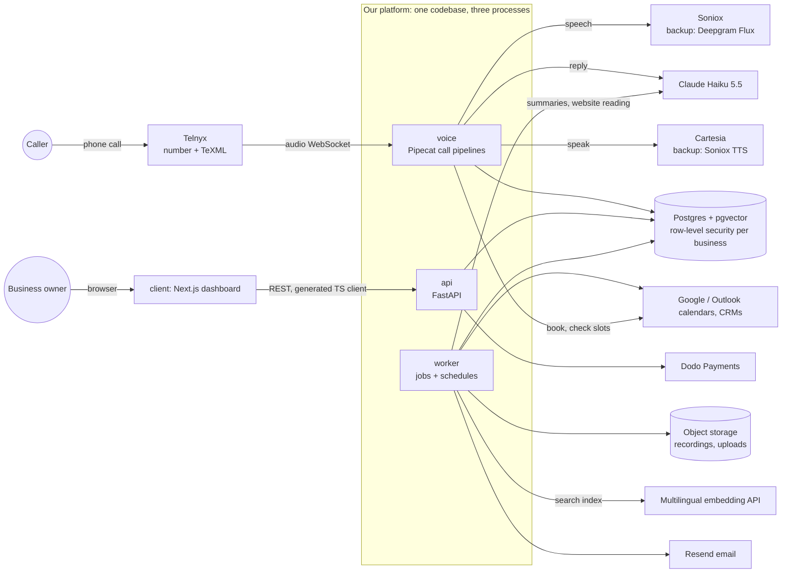

# AI Receptionist: Architecture

How the product is built, from a one-person plumbing business to a large hospital, while keeping every plan at an 80%+ margin. Written 2026-10-31. Cloud prices are approximate list prices; check them in the AWS Pricing Calculator before buying.

---

## 1. Principles

1. **One backend language: Python.** The call framework (Pipecat) and the AI libraries are Python, so the API, live calls and background jobs all use it. The dashboard is the only TypeScript part.
2. **One codebase, three processes.** The code is the same, but it runs as three processes with different jobs, so a slow job never delays a live call:
   - `api`: the dashboard's REST API;
   - `voice`: live calls;
   - `worker`: background jobs and schedules.
3. **Every customer shares one platform.** Each business's data is kept apart inside the database itself (Postgres row-level security). A separate deployment is only for enterprise contracts that pay for it, built from the same code and the same infrastructure templates.
4. **Pay only for what runs.** No Kubernetes, no load balancer, no Redis and no separate vector database until real load needs them. Postgres does the database, the search index, the job queue and the locks.
5. **No AI models on our servers.** Listening, thinking and speaking all go through provider APIs, so servers stay small and need no GPU. Every provider has a backup.
6. **A live call must never go silent.** If a provider fails, switch to its backup. If everything fails, apologise, take a message or transfer to a person.
7. **One source of truth for the API.** FastAPI publishes an OpenAPI description, and the dashboard's TypeScript client is generated from it, so the two can't drift apart.
8. **Everything reproducible:** infrastructure as code, images built once in CI, the same images in staging and production, secrets per environment and per process.

---

## 2. System diagram



---

## 3. Components

| Part | What it does | How it scales |
|---|---|---|
| **client** (Next.js, React, Tailwind, shadcn/ui) | Sign-up, setup wizard, business info, voice and languages, phone numbers, call history, billing | Static plus server rendering; runs as a container on the same server at first, then moves to a CDN host |
| **api** (FastAPI) | Accounts and login, businesses, numbers, agent settings, calls, billing, webhooks (Telnyx, Dodo, calendars) | Stateless; add copies behind the load balancer |
| **voice** (FastAPI + Pipecat) | Receives each call's audio from Telnyx, runs listen → think → speak, calls tools (book, transfer, take a message, end the call), saves the call | Stateless between calls; each server handles dozens of calls at once (to be measured). Add servers as calls grow |
| **worker** (Python) | Call summaries and emails, reading business websites into the search index, calendar and CRM sync, usage counting for billing, data-retention cleanup | Takes jobs from a Postgres table (`FOR UPDATE SKIP LOCKED`); schedules use a Postgres lock so only one copy runs them |
| **Postgres 17 + pgvector** | All data, the knowledge search index, the job queue, locks | Managed database with daily backups and 7-day point-in-time restore; larger instance as needed |
| **Object storage** | Call recordings (off by default), uploaded documents | Pay per GB, with lifecycle rules that delete old files |

---

## 4. A call, step by step

1. A caller dials a business's number. Telnyx runs our single TeXML app, which streams the call audio to `wss://voice.<domain>/telnyx/media/<token>`.
2. **voice** checks the token, reads the dialed number and loads that number's **agent settings**: languages, voice, greeting, business info, enabled tools and transfer numbers. Settings are cached for a few minutes.
3. **voice** builds the pipeline for that agent:
   - the listening service: Soniox, or Flux for its 10 languages if testing proves it better;
   - Claude Haiku 5.5 for replies, with thinking off;
   - Cartesia, using the business's chosen voice or the owner's clone.

   Common phrases (greeting, AI and recording notice, goodbyes) are played from pre-recorded audio.
4. During the call:
   - the voice follows the caller's language;
   - Claude answers from the business's info (knowledge search in pgvector);
   - Claude calls tools: checking and booking calendar slots, transfers through Telnyx, recording a message.
5. Limits protect the margin: a call-length cap, hang-up after long silence, and blocking known spam numbers before the AI answers.
6. When the call ends, **voice** saves the call record:
   - number, language and duration;
   - per-turn delays;
   - cost split by provider;
   - outcome (booked, message, transferred, spam);
   - transcript.

   It then queues a `summarize_call` job.
7. **worker** writes the summary with Claude, emails the owner (Resend), pushes the lead to their CRM if connected, and adds the minutes to the usage ledger for billing.

---

## 5. Data model (first version)

Every table below `organizations` carries `organization_id`, and row-level security limits each request to its own organization.

| Table | Holds |
|---|---|
| `organizations` | The paying customer: plan, billing status, region, HIPAA mode on/off |
| `users`, `memberships` | People who log in, and their role in each organization (owner, admin, staff) |
| `locations` | Branches, hotel properties, hospital departments: address, hours, time zone |
| `agents` | One receptionist setup: greeting, languages, voice, business info, enabled tools, transfer numbers |
| `phone_numbers` | Telnyx numbers → agent and location |
| `knowledge_sources`, `knowledge_chunks` | Website pages and documents, split into chunks with embeddings (pgvector) |
| `calls` | One row per call: numbers, language, duration, outcome, cost by provider, delays, transcript |
| `messages`, `bookings` | What the AI captured for the business |
| `usage_ledger` | Minutes and add-ons per billing period, which drives overage billing |
| `integrations` | Calendar and CRM connections (tokens encrypted) |
| `jobs` | Background job queue |
| `audit_log` | Who changed or viewed what, which hospitals and large companies require |

---

## 6. Customers of every size

| Customer | Where they run | Extra |
|---|---|---|
| Small businesses, business people | Shared platform | Self-serve plans |
| Hotels, chains, mid-size companies | Shared platform, several locations and numbers per organization | Department routing, single sign-on later |
| Hospitals (US) | Shared platform with **HIPAA mode** at first; a dedicated deployment if the contract requires it | HIPAA mode: only vendors with a signed business associate agreement (BAA), no call recordings, short transcript retention, audit log, no medical advice |
| Enterprise with data-residency rules | Their own deployment in the required region, from the same templates | Priced into the contract; separate database with backups |

**Regions:**
- Start in **AWS us-east-1**.
- Add **EU (Frankfurt or Ireland)** as a second copy of the same stack for European customers' data.
- Add **India (Mumbai)** when we sell there, because Indian rules require call audio to be handled in India.

An organization's region is chosen at sign-up and doesn't move.

---

## 7. Reliability

- **Provider backups:** listening Soniox → Flux; voice Cartesia → Soniox TTS; Claude retried once, then a fallback message.
- **If everything fails:** the AI says "Sorry, I'm having trouble. Let me take your number and the team will call you back", or transfers to the business.
- **Deploys don't cut live calls:**
  - new calls go to the new **voice** version;
  - old servers finish their calls, which is at most the call-length cap, then stop;
  - **api** uses blue/green: start the new version, switch traffic, stop the old.
- **Health checks and alerts:** each process has a health URL; uptime checks alert on failure; Sentry collects errors.
- **Database:** managed Postgres with backups and point-in-time restore. Every schema change goes through a migration.

---

## 8. Security

- **Secrets per environment and per process,** in AWS Secrets Manager. Each process gets only the keys it needs, and no server holds keys that can create cloud resources.
- **Signed webhooks:** Telnyx and Dodo webhooks are signature-checked, and the call stream needs a secret token.
- **Encryption** at rest (database, storage, integration tokens) and in transit (TLS everywhere).
- **Caller privacy:** phone numbers and personal details are masked in logs; transcripts are deleted after a set period (90 days by default, shorter in HIPAA mode); everything for a caller or a business can be deleted on request.
- **Least access:** separate AWS accounts or projects for staging and production.

---

## 9. Infrastructure and cost by stage

| Stage | Setup | Approx. cost/month |
|---|---|---|
| **1. Launch** (0–100 customers) | 1 production server (EC2 t4g.large: 2 vCPU, 8 GB) running client, api, voice and worker with Docker Compose, Caddy for HTTPS; 1 small staging server (t4g.small); RDS Postgres db.t4g.small with backups; S3 | **~$90–110** |
| **2. Growth** (100–1,000 customers, first hotels) | 2+ voice servers and 1 api + worker server behind a load balancer (WebSockets supported); bigger RDS with a standby copy in a second availability zone (Multi-AZ) | **~$300–450** |
| **3. Enterprise** (hospitals, residency contracts) | Stage 2 plus dedicated deployments per contract and an EU or India copy, from the same infrastructure templates | Priced into each contract |

Provider usage (calls) is separate. It's ~$0.031 per call minute, covered by the plans in the README.

**On purpose, not used yet:**
- **Kubernetes, ECS:** add when we run more than about 5 servers.
- **Redis:** Postgres handles queues and locks until it can't.
- **A separate vector database:** pgvector is enough for per-business knowledge.
- **NAT gateways:** expensive. Use public subnets with tight firewalls until a customer requires private networking.
- **Microservices:** three processes from one codebase is enough.

---

## 10. Folder structure

```text
Ai-receptionist/
├── README.md                 product, languages, stack, costs, pricing, break-even
├── docs/
│   ├── architecture.md       this file
│   └── decisions.md          dated decisions and why
├── server/                   Python 3.12 · FastAPI · Pipecat · SQLAlchemy · Alembic
│   ├── pyproject.toml  uv.lock  .env.example  alembic.ini
│   ├── core/                 settings, database session, tables, row-level security, security helpers
│   ├── api/                  process 1: dashboard REST API
│   │   ├── main.py
│   │   └── routes/           auth, organizations, agents, numbers, calls, billing, webhooks
│   ├── voice/                process 2: live calls
│   │   ├── main.py           FastAPI app with the Telnyx WebSocket
│   │   ├── call.py           builds the pipeline for an agent
│   │   ├── providers.py      picks listening service and voice, with backups
│   │   ├── phrases.py        pre-recorded common phrases
│   │   ├── telnyx.py         numbers, transfer, hang up
│   │   ├── language.py  prompt.py  texml.py
│   │   └── tools/            book, check_slots, transfer, take_message, end_call
│   ├── worker/               process 3: background jobs and schedules
│   │   ├── main.py
│   │   └── jobs/             summarize_call, send_email, read_website, sync_usage, cleanup
│   ├── knowledge/            website reading, chunking, embeddings, search
│   ├── integrations/         google_calendar, outlook, hubspot, salesforce, resend, dodo
│   ├── billing/              plans, usage ledger, overage
│   ├── migrations/           database changes
│   ├── evals/                scripted test calls per language (cost money; run on demand)
│   └── tests/                fast tests, no network
├── client/                   Next.js dashboard
│   ├── app/                  pages
│   └── lib/api/              TypeScript client generated from the server's OpenAPI
├── infra/
│   ├── terraform/            AWS: servers, database, storage, DNS, secrets (one module per stack)
│   ├── compose/              prod.yml, staging.yml, dev.yml (local Postgres + pgvector)
│   ├── caddy/                HTTPS and routing
│   └── docker/               server.Dockerfile, client.Dockerfile
└── .github/workflows/        ci.yml (lint, tests, typecheck, build images), deploy.yml
```

The week-1 code already sits in `server/voice` and `server/core`. Moving to this layout means splitting `voice/routes.py` into `voice/main.py`, adding `worker/` and the database layer, and creating `client/` and `infra/`.

---

## 11. Build order

1. **Foundation:** git repository; CI; local Postgres; `core` database layer with organizations, agents, phone numbers and calls under row-level security. **Done 2026-10-31**; see [development.md](development.md).
2. **Voice:** switch to Soniox with provider backups; load the agent from the dialed number; save every call; pre-recorded phrases.
3. **Worker:** call summaries and email; usage ledger.
4. **Knowledge and tools:** website reading into pgvector; booking, transfer and message tools.
5. **Dashboard:** sign-up, setup wizard, call history.
6. **Billing:** plans, overage, Dodo.
7. **Infrastructure:** Terraform for stage 1; staging, then production; real test calls in every launch language.
